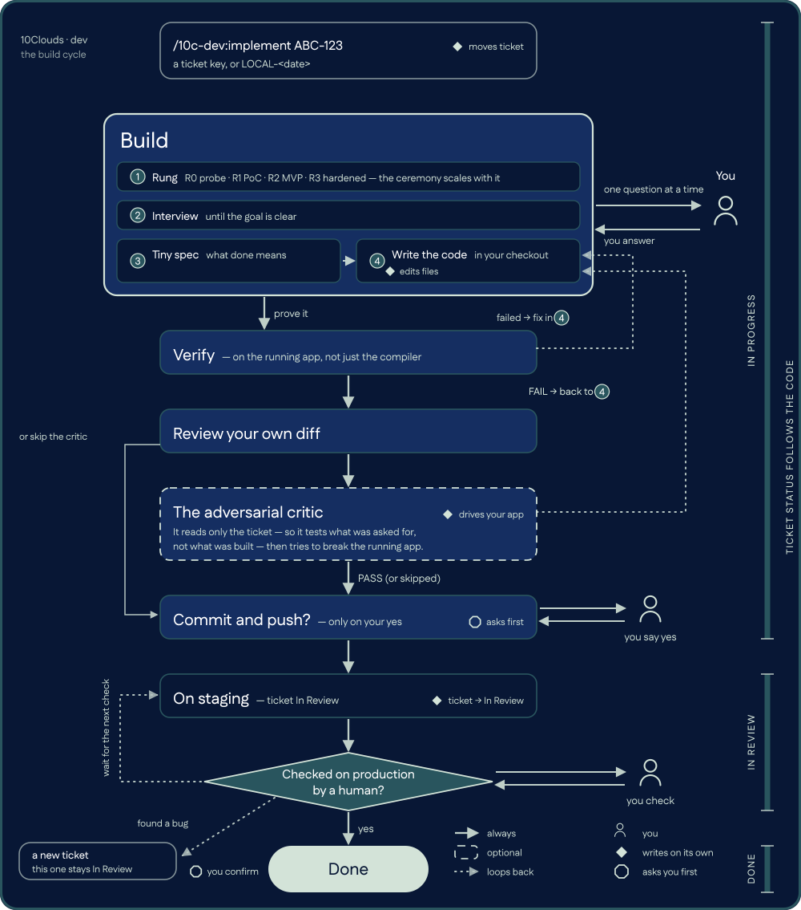

<p align="center">
  
</p>

<p align="center">
  
  
  
</p>

```
/plugin marketplace add 10Clouds-FI/10c-dev
/plugin install 10c-dev@10c-dev
```

## Why

Agentic coding fails in repeatable ways: guessing instead of asking, building a cathedral when a
shed was asked for, calling it done because it compiled, and parallel sessions pushing each other's
half-finished commits. This plugin encodes the process that closes each of those, and knows
nothing about your stack: everything project-specific is one file in your repository.

## What it does

<p align="center">
  
</p>

Work starts from a ticket key, or a synthetic `LOCAL-<date>-<time>` for untracked work. Before any
code, the session states a **rung** — R0 probe, R1 PoC, R2 MVP, R3 hardened — defaults to the
lowest one that answers the request, and climbs only with your agreement.

It then **interviews** you one question per message until the goal can be stated without hedging,
posts a tiny spec in the chat, and builds the smallest thing that works. It proves the change on
the running app rather than on a green compile, reviews its own complete diff, and closes with a
cleanup pass over what the change just made pointless.

The ticket status is derived from where the code is, never from how the conversation went:
**In Progress** while it is local, **In Review** once pushed or in a PR, **Done** only after a
human checked it in production. Longer version: [`docs/process.md`](docs/process.md).

## Skills

| Command | What it does |
|---|---|
| `/10c-dev:setup` | One-time machine and repo onboarding; writes `.claude/task-flow.json` |
| `/10c-dev:implement` | The full cycle above for one ticket, start to push |
| `/10c-dev:coding` | The build phases on their own: rung, interview, spec, minimal build |
| `/10c-dev:code-review` | Review of a diff, branch or PR, with a severity-ranked verdict |
| `/10c-dev:cleanup` | What did this change make pointless — remove the obvious, propose the rest |
| `/10c-dev:project-model` | A map of what each part of the codebase is *for* |
| `/10c-dev:jira` | Read and move tickets: JQL search, issue detail, comment, transition, board |
| `/10c-dev:slack` | Read and post in Slack through the `agent-slack` CLI |

Most of these also fire on their own when the task calls for them; `implement` is the one you
invoke by name. Plus one agent, `@critique-agent`: it reads the ticket, never the source, drives
the live app through at least five scenarios trying to break it, and returns PASS or FAIL. Run it
once, at the end.

### Connectors

 —
reads tickets, moves them between statuses, and comments on them. Either the `atlassian` MCP
server this plugin declares (OAuth in the browser, per user, nothing stored in the repo) or an API
token for the bundled scripts. Set `"tracker": "none"` to run the workflow with no tracker at all.

 —
reads channels, DMs and threads and posts messages, so a session can send a heads-up before a
risky push. It runs through the `agent-slack` CLI, which reuses the session from your Slack desktop
app, so no token is typed anywhere. Optional; nothing in the cycle depends on it.

## Install

Both routes are verified on this plugin — hooks, MCP servers, agents and skills all load. The
marketplace route is the two commands at the top, run inside Claude Code; the repository is its own
marketplace, so both names are `10c-dev`. Then run `/10c-dev:setup` once.

<details>
<summary>From a shell, or clone-and-symlink to edit the workflow as you use it</summary>

```bash
claude plugin marketplace add 10Clouds-FI/10c-dev
claude plugin install 10c-dev@10c-dev
```

```bash
git clone https://github.com/10Clouds-FI/10c-dev.git ~/src/10c-dev
cd ~/src/10c-dev && ln -sfn "$PWD" ~/.claude/skills/10c-dev
```

The symlinked copy loads on the next session as `10c-dev@skills-dir` with no install step,
including the hooks and the two MCP servers. Edits to a `SKILL.md` take effect immediately;
changes to `hooks/`, `.mcp.json` or `agents/` need `/reload-plugins` or a fresh session.

Either way, confirm with `claude plugin list` and `claude plugin details 10c-dev`.

**Updating:** `claude plugin marketplace update 10c-dev`. Installed copies pick up a new version
when `version` in `.claude-plugin/plugin.json` changes; a symlinked clone updates with `git pull`
plus `/reload-plugins`.

</details>

`/10c-dev:setup` walks a machine and a repository through setup one step at a time, verifying each
step with real output: runtimes, the ticket tracker, Slack, the Playwright browser, then an
interview that writes this repo's config, and an end-to-end check on a real ticket.

## Configuration

One file in your repository, committed: `.claude/task-flow.json`. `/10c-dev:setup` writes it by
interview; [`templates/task-flow.schema.md`](templates/task-flow.schema.md) documents every field.

```json
{
  "tracker": "jira",
  "jira": { "site": "https://your-org.atlassian.net", "projectKey": "ABC" },
  "git": { "baseBranch": "main", "mode": "pr", "branchPrefix": "feature/" },
  "verify": { "commands": ["make lint"], "byArea": { "src/web": ["npm test"] } },
  "app": { "start": "make start", "urls": { "app": "http://localhost:3000/" } },
  "rules": { "src/web": [".claude/rules/frontend.md"] }
}
```

<details>
<summary>The rest of the config, and where credentials live</summary>

`hotspots` names the paths where two sessions colliding is expensive, and `reporting` sets the
language and tone of ticket comments. `tracker: "none"` is valid: the workflow then runs on
synthetic `LOCAL-<date>-<time>` keys and skips every tracker call.

**No credentials go in that file** — it is committed to your repository.

- **Jira** — either the `atlassian` MCP server (OAuth in the browser, per user), or
  `JIRA_EMAIL` / `JIRA_API_TOKEN` in the environment, or `python3 skills/jira/scripts/setup.py`,
  which stores them under `$CLAUDE_PLUGIN_DATA/jira/credentials.json`, outside the repository.
- **Slack** — `agent-slack auth import-desktop` reuses the session from the Slack desktop app, so
  no token is typed anywhere. `SLACK_BOT_TOKEN` is the alternative. See
  [`skills/slack/SETUP.md`](skills/slack/SETUP.md).
- **Playwright** — no credentials; `npx playwright install chromium` once.

</details>

## The session board

Several sessions on one machine, often on one checkout, is the normal case and the usual source of
expensive accidents. Six hooks maintain a board under `~/.claude/10c-dev/board/`, one JSON file per
live session, and feed each session a digest of its neighbours: who is here, which ticket, which
phase, which branch, which files. It reports a **file overlap** before your first edit, raises a
blocker on the **hotspots** you listed, asks before restarting a **local stack** a neighbour is
verifying against, and names any neighbour sharing the checkout **before a push** — one pusher at a
time. The checks run as hooks, so a session cannot skip them by not looking.

```bash
python3 "$CLAUDE_PLUGIN_ROOT/hooks/board.py" overview   # live sessions on this repo
python3 "$CLAUDE_PLUGIN_ROOT/hooks/board.py" overlap    # files you and a neighbour both touch
```

More in [`hooks/README.md`](hooks/README.md).

## Contributing

Tests, manifest validation and the no-internal-identifiers check are in
[`CONTRIBUTING.md`](CONTRIBUTING.md). `claude --plugin-dir .` loads the working copy for a session,
ahead of any installed copy.

## License

MIT — see [`LICENSE`](LICENSE).
