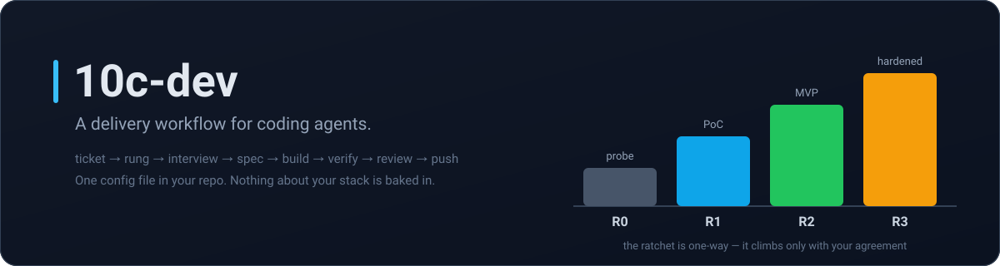

<p align="center">
  
</p>

<p align="center">
  A Claude Code plugin that turns "ask the agent to build a thing" into a repeatable delivery cycle.
</p>

<p align="center">
  <a href="LICENSE"></a>
  
  
  
</p>
<!-- TODO: add a tests badge once a GitHub Actions workflow exists (there is none yet). -->

```
/plugin marketplace add 10Clouds-FI/10c-dev
/plugin install 10c-dev@10c-dev
/10c-dev:setup
```

## Why

Agentic coding fails in a few repeatable ways: the agent guesses instead of asking, builds a
cathedral when a shed was asked for, calls it done because the code compiled, reviews nothing,
and leaves behind code nobody dares delete. On a shared machine, parallel sessions then edit the
same files and push each other's half-finished commits. Every part of this plugin closes one of
those. Everything project-specific lives in one file in *your* repository
(`.claude/task-flow.json`) — the plugin itself knows nothing about your stack.

## Skills

| Command | What it does |
|---|---|
| `/10c-dev:setup` | One-time machine and repo onboarding; writes `.claude/task-flow.json` |
| `/10c-dev:implement` | The full build cycle for one ticket, start to push |
| `/10c-dev:coding` | The build phases on their own: rung, interview, spec, minimal build, cleanup |
| `/10c-dev:code-review` | Structured review of a diff, branch or PR, with a severity-ranked verdict |
| `/10c-dev:cleanup` | What did this change just make pointless — remove the obvious, propose the rest |
| `/10c-dev:project-model` | Build and maintain a map of what each part of the codebase is *for* |
| `/10c-dev:jira` | Read and move tickets: JQL search, issue detail, comment, transition, board |
| `/10c-dev:slack` | Read and post in Slack through the `agent-slack` CLI (optional) |

Most of these also fire on their own when the task calls for them — `implement` is the one you
invoke by name. Plus one agent, `@critique-agent`: an adversarial black-box verifier. Give it a
ticket key and a URL; it reads no source and edits nothing, builds at least five scenarios, and
returns PASS or FAIL. Run it **once**, at the end — looping it produces endless nitpicks.

## How the cycle works

```mermaid
flowchart LR
  T["Ticket ABC-123<br/>or LOCAL-date-time"] --> P["In Progress"]
  P --> R["Rung, interview,<br/>tiny spec"]
  R --> B["Smallest thing<br/>that works"]
  B --> V["Verify on<br/>the live app"]
  V --> S["Self-review<br/>+ critic"]
  S --> C["Cleanup +<br/>project model"]
  C --> U["Commit and push<br/>(only on your yes)"]
  U --> IR["In Review"]
  IR --> H["Human checks<br/>production"]
  H --> D["Done"]
```



1. Work starts from a ticket key, or a synthetic `LOCAL-<date>-<time>` for untracked work.
2. The session states a **rung** — R0 probe, R1 PoC, R2 MVP, R3 hardened — and defaults to the
   lowest one that answers the request. The ratchet is one-way: it climbs only with agreement.
3. It **interviews** you first — one question per message, never a list — until it can state the
   goal without hedging. Then it pushes back with what could go wrong and a cheaper path.
4. It posts a **tiny spec** in chat: goal, two to four "done when" conditions written from your
   side, what is out of scope, the plan. Never as a file in your repo.
5. It builds the **smallest thing that works**, loading your repo's own rules for the area it is
   touching. Tests from R2 up; a bug gets a reproducing test first.
6. It **proves it on the live app** — the real browser, the real endpoint. Compiling is not the
   feature working, and it will not fabricate a browser result.
7. It **reviews its own complete diff**, fixes blockers and majors, and hands you the rest.
8. It closes with **cleanup** and a project-model update, then *offers* to commit and push.
9. **The ticket status follows the code**: In Progress while local, In Review once it is on the
   base branch or in a PR, Done only after a human checked it on production.

Longer version, for someone deciding whether to adopt it: [`docs/process.md`](docs/process.md).

## Install

Both routes are verified on this plugin — hooks, MCP servers, agents and skills all load.

**Marketplace (recommended).** The three commands at the top, inside Claude Code. The repository
is its own marketplace, so both names are `10c-dev`.

<details>
<summary>From a shell, or clone-and-symlink if you want to edit the workflow as you use it</summary>

```bash
claude plugin marketplace add 10Clouds-FI/10c-dev
claude plugin install 10c-dev@10c-dev
```

```bash
git clone https://github.com/10Clouds-FI/10c-dev.git ~/src/10c-dev
ln -sfn ~/src/10c-dev ~/.claude/skills/10c-dev
```

The symlinked copy loads on the next session as `10c-dev@skills-dir` with no install step —
confirmed with `claude plugin list`, including the hooks and the two MCP servers. Edits to a
`SKILL.md` take effect immediately; changes to `hooks/`, `.mcp.json` or `agents/` need
`/reload-plugins` or a fresh session.

Either way, confirm with `claude plugin list` and `claude plugin details 10c-dev`.

**Updating:** `claude plugin marketplace update 10c-dev`. Installed copies pick up a new version
when `version` in `.claude-plugin/plugin.json` changes; a symlinked clone updates with `git pull`
plus `/reload-plugins`.

</details>

## First run

`/10c-dev:setup` walks a machine and a repository through setup one step at a time, verifying
each step with real output before moving on: runtimes (python3 ≥ 3.10, node ≥ 20, `gh`), the
ticket tracker, Slack (optional), the Playwright browser, then an interview that writes this
repo's `.claude/task-flow.json`, and finally an end-to-end check that the board sees the session
and the tracker answers on a real ticket. Then, for each piece of work: `/10c-dev:implement ABC-123`.

## Configuration

One file in your repository, committed: `.claude/task-flow.json`. `/10c-dev:setup` writes it by
interview; [`templates/task-flow.json`](templates/task-flow.json) is the skeleton and
[`templates/task-flow.schema.md`](templates/task-flow.schema.md) documents every field.

```json
{
  "tracker": "jira",
  "jira": { "site": "https://your-org.atlassian.net", "projectKey": "ABC", "board": 123 },
  "git": { "baseBranch": "main", "remote": "origin", "mode": "pr", "branchPrefix": "feature/" },
  "verify": { "commands": ["make lint"], "byArea": { "src/web": ["npm test"] } },
  "app": { "start": "make start", "urls": { "app": "http://localhost:3000/" } },
  "rules": { "src/web": [".claude/rules/frontend.md"] },
  "hotspots": ["src/api/routes.py"],
  "reporting": { "language": "en", "commentStyle": "technical" }
}
```

`tracker: "none"` is valid: the workflow then runs on synthetic `LOCAL-<date>-<time>` keys and
skips every tracker call. **No credentials go in this file** — it is committed to your repo.

<details>
<summary>Credentials</summary>

- **Jira** — either the `atlassian` MCP server this plugin declares (OAuth in the browser, per
  user, nothing stored in the repo), or an API token for the bundled scripts: `JIRA_EMAIL` /
  `JIRA_API_TOKEN` in the environment, or `python3 skills/jira/scripts/setup.py`, which stores
  them under `$CLAUDE_PLUGIN_DATA/jira/credentials.json`, outside the repository.
- **Slack** — `agent-slack auth import-desktop` reuses the session from the Slack desktop app, so
  no token is typed anywhere. `SLACK_BOT_TOKEN` is the alternative. See
  [`skills/slack/SETUP.md`](skills/slack/SETUP.md).
- **Playwright** — no credentials; `npx playwright install chromium` once.

</details>

## The session board

Several sessions on one machine, often on one checkout, is the normal case and the usual source
of expensive accidents. Six hooks maintain a board under `~/.claude/10c-dev/board/`, one JSON
file per live session, and feed each session a digest of its neighbours: who is here, which
ticket, which phase, which branch, which files. It reports a **file overlap** before your first
edit, raises a blocker on the **hotspots** you listed, asks before restarting a **local stack**
a neighbour is verifying against, and names any neighbour sharing the checkout **before a
push** — one pusher at a time. The checks run as hooks, so a session cannot skip them by not
looking. By hand:

```bash
python3 "$CLAUDE_PLUGIN_ROOT/hooks/board.py" overview   # live sessions on this repo
python3 "$CLAUDE_PLUGIN_ROOT/hooks/board.py" overlap    # files you and a neighbour both touch
```

More in [`hooks/README.md`](hooks/README.md).

## Contributing

Tests, manifest validation and the no-internal-identifiers check are in
[`CONTRIBUTING.md`](CONTRIBUTING.md). `claude --plugin-dir .` loads the working copy for a
session, ahead of any installed copy.

## License

MIT — see [`LICENSE`](LICENSE).
